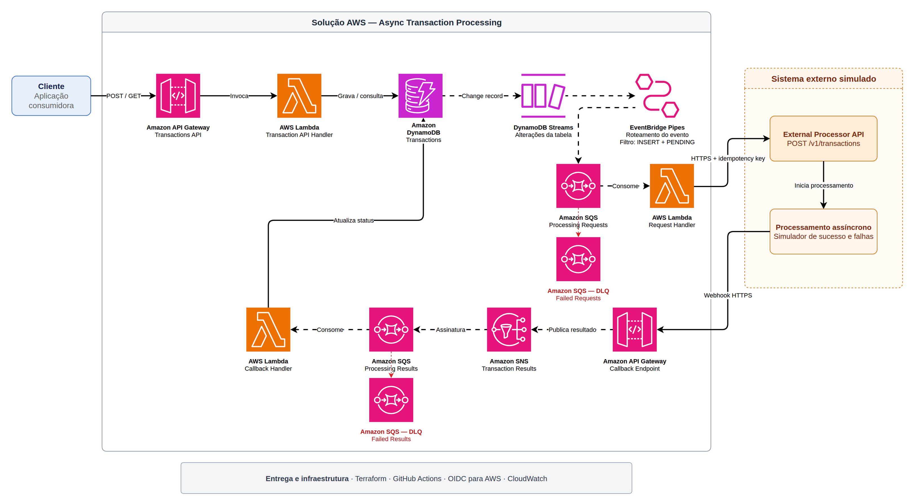

# Async Transaction Processing

Independent AWS portfolio lab for asynchronous transaction processing. A client
receives `202 Accepted`, while messaging coordinates submission to a simulated
external processor and applies its eventual result. All transfers are synthetic:
this project does not connect to a bank, payment network or real customer account.

The problem being demonstrated is how to accept work without holding a client
connection open until an external processor finishes, while handling retries,
duplicate delivery and conflicting results without silently creating new work or
overwriting a completed transaction.

This repository is the **entry point for the complete five-repository solution**.
Application code lives in four independently built/deployed repositories;
Terraform and central delivery orchestration live here.

**Start here:** [reproduce the lab from scratch](docs/reproduce.md).
You can also [run a short demonstration](#manual-demonstration) after deployment.
See [contracts and state transitions](docs/contracts.md) for payloads, acknowledgement
boundaries, idempotency and current propagation/validation limits.
Repository access is required; documentation does not change repository visibility.

## Repositories and responsibilities

| Repository | Responsibility | AWS execution |
| --- | --- | --- |
| [async-transaction-api](https://github.com/MarcondesOliveira/async-transaction-api) | Validate, create and query transactions; Swagger/OpenAPI | HTTP API Gateway + Lambda |
| [async-transaction-request-handler](https://github.com/MarcondesOliveira/async-transaction-request-handler) | Consume requests, submit to the processor and classify submission failures | SQS-triggered Lambda |
| [async-transaction-callback-handler](https://github.com/MarcondesOliveira/async-transaction-callback-handler) | Apply final results idempotently and prevent conflicting terminal updates | SQS-triggered Lambda |
| [external-transaction-processor-simulator](https://github.com/MarcondesOliveira/external-transaction-processor-simulator) | Independently accept operations and deliver deterministic asynchronous callbacks | Own HTTP API, two Lambdas, DynamoDB/Stream |
| [async-transaction-infrastructure](https://github.com/MarcondesOliveira/async-transaction-infrastructure) — this repository | Provision AWS, manage state/permissions and orchestrate routine delivery | Terraform + GitHub Actions/OIDC |

Four application repositories plus infrastructure, not five independent HTTP
APIs. Request and Callback Handlers expose no HTTP listener or Swagger.
No shared deployment-time library couples the services.

## Architecture



[Open the full-resolution diagram](docs/architecture/async-transaction-processing.drawio.png).
The PNG embeds its editable draw.io source; open it in draw.io to inspect or edit.
This is a logical overview: the simulated external system is a separate stack in
the same AWS account. Its internal HTTP API, two Lambdas, table/Stream and worker
failure destination are described in the
[simulator repository](https://github.com/MarcondesOliveira/external-transaction-processor-simulator).
For exact payloads, acknowledgements and state rules, see
[contracts and state transitions](docs/contracts.md).

## What happens to a transaction

1. Client calls `POST /transactions` with an `Idempotency-Key`.
2. Transaction API atomically stores the transaction as `PENDING` and an
   idempotency record in DynamoDB, then returns `202 Accepted`.
3. DynamoDB Streams and EventBridge Pipes select only transaction
   `INSERT + PENDING` records and send a versioned request to SQS.
4. Request Handler consumes SQS, calls the simulator over HTTPS with an
   idempotency key and conditionally marks acceptance as `PROCESSING`.
5. Simulator API stores an independent operation and returns `202`.
   Its DynamoDB Stream triggers a separate worker; it does not keep work running
   in the background of an HTTP Lambda after returning.
6. Worker sends the final event to the callback REST API Gateway.
   The gateway validates JSON and publishes directly to SNS.
7. SNS delivers raw JSON to the results SQS queue. Callback Handler atomically
   records the callback receipt and applies the final transaction state.
8. Client calls `GET /transactions/{transactionId}` to read the result.

`PENDING` and `PROCESSING` are transient; `SUCCEEDED`, `REJECTED` and `FAILED`
are terminal. A valid callback can arrive before the Request Handler's status
update; it may therefore complete a `PENDING` transaction directly.
A later acceptance must not overwrite that final result.

Request/result queues have DLQs and partial-batch failure handling.
The simulator Stream failure destination stores invocation metadata, not the
original callback body; it is not an ordinary SQS callback redrive.
See [operational inspection and recovery](docs/lab-operations.md).

## Decisions worth examining

- **Serverless, not Kubernetes:** managed `dotnet10`, ARM64 Lambda ZIPs, HTTP
  APIs and DynamoDB on-demand keep the demonstration free of always-on cluster,
  NAT Gateway and provisioned-compute requirements. Usage is still billable.
- **Separate simulator:** its endpoint, table, roles and repository are independent;
  the main Request Handler knows its HTTP contract, not its storage implementation.
  It runs in the same AWS account for this lab, not a separate organization's account.
- **State-driven dispatch:** persisting the initial transaction produces the
  Stream event; API code does not independently write to DynamoDB and SQS and risk
  only one write succeeding. Pipe filtering prevents updates/receipts from looping.
- **Idempotency rather than exactly-once promises:** delivery/retries can repeat
  messages and HTTP requests. Stable keys, transactional writes and conditional
  state transitions make repetition safe within the documented retention limits.
- **Independent packages, centralized infrastructure:** a service delivery
  overrides only its own immutable package key/hash. Other deployed versions are
  read from current Terraform state, not restored from stale local tfvars.

### Why one POST creates two DynamoDB records

`TRANSACTION#<id>` is the business representation; `IDEMPOTENCY#<key>` maps the
client key and normalized-body hash to that transaction. An atomic write creates
both, so a retry after a lost HTTP response cannot silently create a second
transaction. Same key/body replays the original transaction; changed content
returns `409 IDEMPOTENCY_KEY_REUSED`.

The Callback Handler later adds `CALLBACK#<eventId>` as a processing receipt.
It detects repeated events and conflicting event-ID reuse without using the
transaction itself as an unbounded history of every callback.

Idempotency records and callback receipts have TTL timestamps at +24 hours.
**The transaction itself has no TTL.** DynamoDB deletes expired items
asynchronously, potentially days later; the repositories can still observe those
records until physical removal. This is not a strict 24-hour key-reuse guarantee.
The simulator's independent operation has its own configurable TTL (default 24 h).
This separates temporary deduplication bookkeeping from the business result,
reduces long-lived housekeeping data, and preserves results for demonstration and
diagnosis. It is a conscious lab tradeoff, not a production retention policy.
[AWS TTL behavior](https://docs.aws.amazon.com/amazondynamodb/latest/developerguide/TTL.html).

## Reproduction order

The [full guide](docs/reproduce.md) supplies commands, example files, configuration
names and checkpoints. Follow it in this order:

1. Obtain/fork the five repositories; run credential-free tests locally.
2. Configure your own owner/repository references and AWS OIDC provider.
3. Review/apply bootstrap with an owner identity, retaining its local state.
4. Build/verify/publish the four initial immutable packages using that owner identity.
5. Owner-provision the simulator stack, then core pointed at its endpoint.
6. Narrow routine deploy permissions to the newly created API/mapping IDs.
7. Configure GitHub variables/secrets and enable automatic delivery.
8. Validate one service push, one infrastructure push and manual POST/GET.
9. Finish evidence, then explicitly authorize final teardown.

**First provisioning is not routine delivery.** The routine role intentionally
cannot create IAM roles or initialize an empty deployment. Do not start a service
delivery against empty state or use a failed deploy as a bootstrap mechanism.
For a different GitHub owner, update the central repository constant in each
service's `.github/scripts/deploy.py` as described in the guide.

## CI/CD after first provisioning

A service main push runs tests/analyzers/audit, packages ARM64, publishes the exact
verified ZIP to S3 through OIDC and dispatches the central Terraform workflow.
The source workflow waits for the exact central run through plan/apply, Lambda
hash/status verification and a synthetic transaction reaching `SUCCEEDED/APPROVED`.
A successful upload or dispatch alone is not successful delivery.

An infrastructure main push runs credential-free CI, then guarded plan/apply for
both stacks, preserving current packages and running independent smoke transactions.
Operational settings are versioned under [`.github/config/`](.github/config/);
account, backend and endpoint configuration stay outside source.
Stacks share per-stack concurrency queues and S3 state locks.

Routine delivery rejects IAM changes, deletion/replacement and out-of-scope
resource actions. Privileged bootstrap/IAM work stays owner-operated.
There is no automatic rollback after a failed apply or smoke.
[Workflow details and authentication](docs/continuous-delivery.md).

## Manual demonstration

For a five-minute walkthrough in Swagger or Bruno, follow the
[short demonstration script](docs/demo.md). It uses the main API, not direct
Lambda invocations, and separates expected validation errors from failures.

Get your deployment URL from `terraform -chdir=stacks/core output -raw transactions_api_url`.
Open `<API_BASE_URL>/swagger/index.html`, or use Bruno/curl.
Send **to the main API**, not to the simulator or callback endpoint:

```http
POST /transactions
Content-Type: application/json
Idempotency-Key: portfolio-demo-0001
```

```json
{
  "transactionType": "TRANSFER",
  "amount": { "value": "1.00", "currency": "BRL" },
  "destination": { "accountId": "portfolio-demo" },
  "externalReference": "portfolio-demo-0001"
}
```

Expect `202` with `transactionId`; poll `GET /transactions/{transactionId}`
until `SUCCEEDED` with `result.code=APPROVED`. Timing is asynchronous, not guaranteed.
Repeat the same POST/key/body to observe the same transaction; change the amount
with that key for `409`. Use a new key for every independent scenario.

Destination prefixes `reject-` and `fail-` produce deterministic terminal results.
`timeout-` exercises transient submission failures/retries, not a successful
callback. Inspect logs/DLQs with the [operations guide](docs/lab-operations.md).
[Main API contract](https://github.com/MarcondesOliveira/async-transaction-api/blob/main/docs/api-contract.md).

## Limits, costs and teardown

This is a temporary portfolio lab, not a financial or production-security system.
Endpoints are public with no caller authentication; callbacks use HTTPS **without
HMAC**. The simulator accepts a supplied HTTPS callback URL without a destination
allowlist. Use synthetic data and a controlled short-lived environment only.
Production needs authentication, webhook verification/replay controls, stricter
destination/tenant boundaries, monitoring and reviewed recovery/retention policies.
[Security review and its limits](docs/security-review.md).

AWS usage, logs/storage and GitHub Actions can incur charges; free-tier coverage
is not assumed. No EKS, NAT or provisioned concurrency is used. Logs default to
7 days; artifacts expire after 30 days (noncurrent versions after 7).
Do not rely on a 30-day-old artifact being available to recreate a Lambda.
The optional USD 5 budget is an alert, not a spending cap.
Estimate your own usage with the [AWS calculator](https://calculator.aws/)
and inspect your GitHub plan's Actions allowance.

[Final lab teardown](docs/final-teardown.md) is manual-only and defaults to a
deletion preview. Destruction requires an explicit final authorization, delivery
freeze, exact confirmation and separately owner-enabled role. Simulator precedes
core; bootstrap is last and owner-operated. **Both bootstrap buckets have
`force_destroy=true`: an approved bootstrap destroy may purge their versions and
objects.** Preserve needed evidence before authorizing it. Never destroy merely
to demonstrate the CI/CD workflow.

### Possible next steps — not implemented here

- Add caller authentication, webhook verification/replay controls and a reviewed
  callback-destination allowlist before any untrusted use.
- Propagate `externalReference` through the Pipe and align independent consumer
  validation with the intended business contract; today's differences are
  documented in [contracts](docs/contracts.md).
- Revisit sequential request batches and timeout budgets for sustained load;
  this lab demonstrates behavior, not a throughput or latency target.
- Add durable reconciliation, reviewed recovery/retention policies, tracing and
  production observability if the operating requirements justify them.
- Consider a GitHub App instead of a temporary cross-repository token for
  longer-lived operation. Refresh pinned third-party actions as their runtimes
  evolve; current deprecation warnings do not invalidate successful runs.

These are future options, not unfinished requirements for the disposable lab.
There is no claim of production readiness, exactly-once delivery, a security
certification or a reproduction of an employer's internal implementation.

## Validation and further reading

Real automatic delivery and synthetic end-to-end smoke passed for all four
application repositories and for infrastructure changes; the owner also checked
the resulting transactions manually. Teardown preparation passed unit tests and
real deletion previews only: no destructive execution is claimed.
Replaying this guide in a second empty AWS account has not been performed as
part of documentation work.

- [From-zero reproduction guide](docs/reproduce.md)
- [Five-minute demonstration](docs/demo.md)
- [Cross-service contracts and states](docs/contracts.md)
- [Continuous delivery and OIDC](docs/continuous-delivery.md)
- [Recovery, retention and logs](docs/lab-operations.md)
- [Security review](docs/security-review.md)
- [Final teardown procedure](docs/final-teardown.md)
- [Callback REST/SNS integration](docs/callback-pipeline.md)
